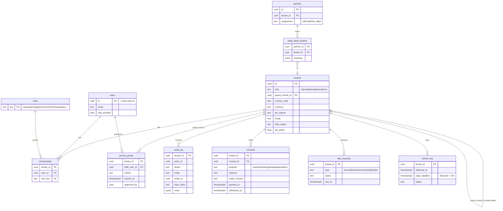
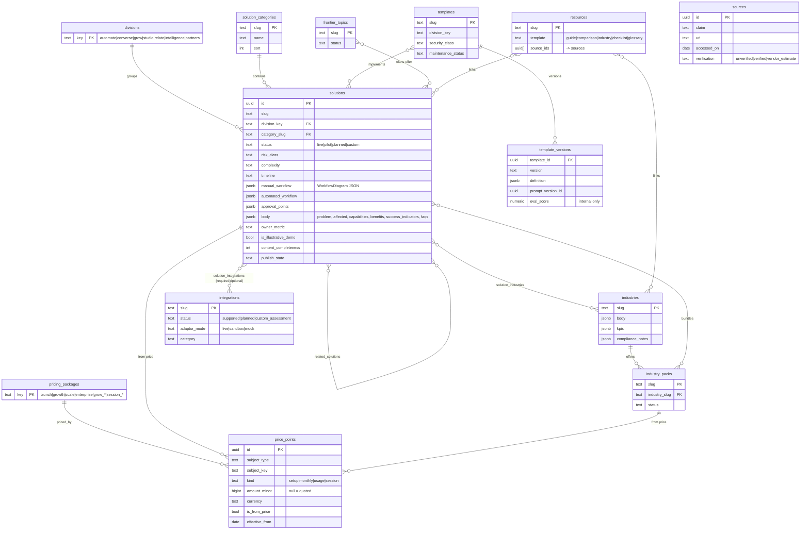
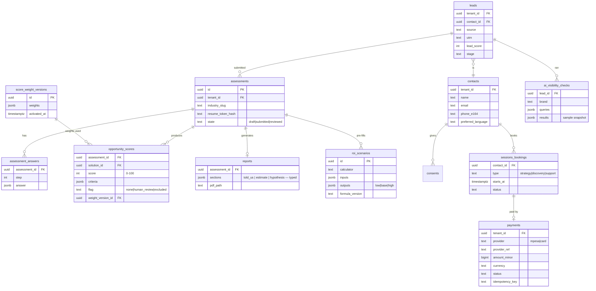
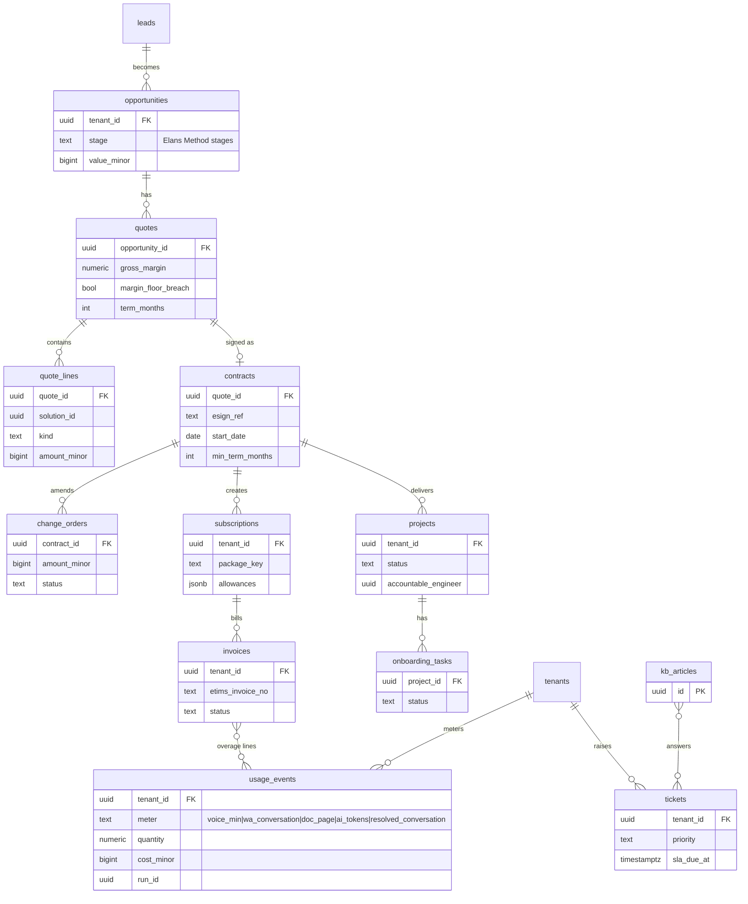
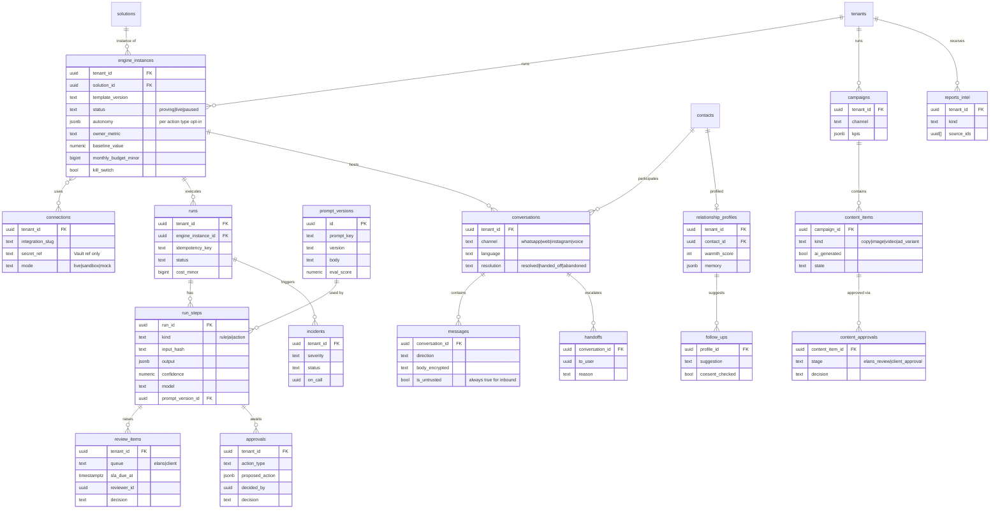

# Elans — Core Data Model (Stage 0 ERD)

Postgres (Supabase). All tables have `id uuid pk`, `created_at`, `updated_at`. Money is
`amount_minor bigint` + `currency char(3)` — never floats. Country, currency, tax regime,
locale and phone format are **configuration** (`tenants`, `site_settings`), never code.

## Tenancy and RLS rules

1. **Global content** (catalogue, industries, pricing, frontier, templates, integrations, resources) has **no `tenant_id`**; public read of `published` rows only; write by Elans `content_editor` role.
2. **Tenant data** carries `tenant_id not null`; RLS policy `tenant_id in (select tenant_id from memberships where user_id = auth.uid())` plus role checks per action.
3. **Pre-tenant data** (assessments, leads, bookings) belongs to the **Elans internal tenant**; when a lead converts, a client tenant is created and relevant records are linked, not moved.
4. **Elans staff** reach a client tenant only via an `access_grants` row (reason, expiry, approver) — every read/write under a grant is audited (D-007).
5. **Partners**: `tenants.parent_tenant_id` models white-label sub-tenants; partner admins see children only through explicit grants.
6. CI runs an RLS isolation suite: two synthetic tenants, every tenant table, select/insert/update/delete must fail across the boundary.

## 1. Identity, tenancy, governance

## 2. Catalogue & content (global)

`sources` mirrors `SOURCES.md` so the CMS can refuse to publish a statistic without a verified source.

## 3. Assessment, scoring, ROI, leads, sessions (Elans internal tenant)

## 4. Commercial (ops console)

## 5. Runtime — automations, agents, growth (tenant data)

Tables named in §21 but merged here: `contacts` is shared by leads, conversations and Relate (one contact graph per tenant).
